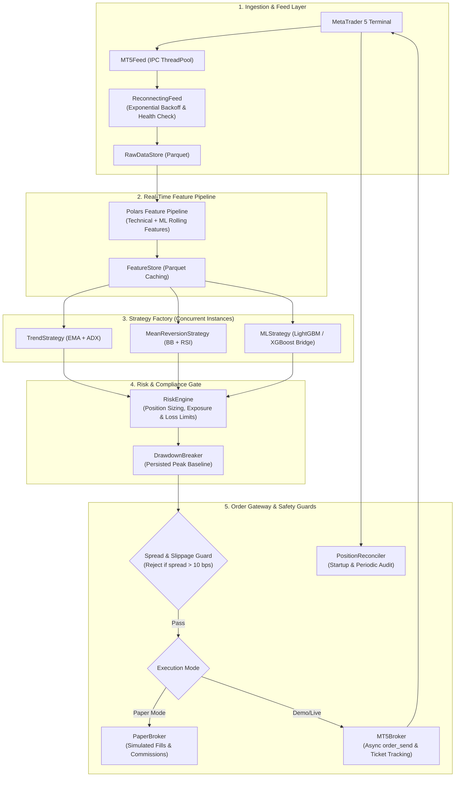

# MetaTrader 5 Asynchronous Execution Gateway (`mt5-execution-gateway`)

> An institutional-grade, asynchronous execution gateway and risk-management engine connecting quantitative machine learning models directly to MetaTrader 5. Designed for real-time order routing, broker position reconciliation, spread blowout protection, and zero-downtime parameter hot-reloading.

**Tech Stack:** Python 3.11 · MetaTrader 5 API · Polars · AsyncIO · Loguru · Pydantic · LightGBM / XGBoost Inference

---

## Architecture & Subsystems

This gateway functions as the **production live/paper execution layer**, fully decoupled from the offline research platform (`qresearch-engine`).



---

## Key Production Engineering Features

### 1. Model-to-Execution Bridge (`MLStrategy`)
* Dynamically consumes serialized model artifacts (`model.txt` / `model.json` + `meta.json`) generated by the research platform (`qresearch-engine`).
* Evaluates incoming completed bars against stationary feature distributions using sub-millisecond C-level inference.
* Maps multiclass probability vectors $[P(\text{SHORT}), P(\text{HOLD}), P(\text{LONG})]$ to actionable signals:
  * Emits entry orders only when confidence exceeds calibrated thresholds ($P \ge 0.40$).
  * Computes dynamic ATR-scaled stop loss and take profit targets directly within the signal payload.

### 2. Spread & Execution Slippage Filter
* High-impact macro events and broker rollover (e.g. 5:00 PM NY close) routinely blow out retail and institutional spreads (widening $5\times - 20\times$).
* `MT5Broker` inspects bid/ask spreads at the exact millisecond of order creation:
  $$\text{Spread}_{\text{pct}} = \frac{P_{\text{ask}} - P_{\text{bid}}}{P_{\text{order}}}$$
* If spread exceeds calibrated limits ($> 40\text{ points}$ or $> 10\text{ bps}$), new entry market orders are rejected immediately before submitting to the broker, shielding the account from severe slippage.

### 3. State Reconciliation & Drawdown Memory
* **Startup Reconciliation:** On process restarts, `PositionReconciler` cross-references internal tracking against live MT5 broker tickets, discovering broker-side stop-loss / take-profit executions and reconciling open inventory.
* **Persistent Peak Drawdown:** `DrawdownBreaker` writes the historical peak equity to disk (`logs/peak_equity.json`). Restarting the bot never resets maximum drawdown limits, preventing circuit-breaker bypass.

### 4. Zero-Downtime Hot-Reloading (`config/live_params.json`)
* Strategy parameters, risk allocations, and circuit breaker thresholds are observed via filesystem timestamp monitors.
* Parameters can be tuned in real-time during live trading without killing the event loop or disconnecting the broker feed.

---

## Directory Structure

```
mt5-execution-gateway/
├── main.py                        ← Main async execution loop & orchestrator
├── config/
│   ├── settings.py                ← Pydantic environment configuration (.env)
│   └── live_params.json           ← Hot-reloadable strategy parameters
├── data/
│   ├── store.py                   ← Raw bar parquet persistence
│   └── feature_store.py           ← Computed feature parquet cache
├── feeds/
│   ├── mt5_feed.py                ← MT5 bar/tick streaming adapter
│   └── reconnect.py               ← Reconnection state machine with backoff
├── features/
│   ├── pipeline.py                ← Polars high-performance feature pipeline
│   ├── technical.py               ← Technical indicators (EMA, MACD, ADX, ATR, BB)
│   └── ml_features.py             ← Rolling return and volatility features
├── strategies/
│   ├── base_strategy.py           ← Abstract base class and Signal dataclass
│   ├── trend.py                   ← EMA crossover with ADX trend filter
│   ├── mean_reversion.py          ← Bollinger Band mean reversion strategy
│   └── ml_strategy.py             ← Live LightGBM/XGBoost inference strategy
├── risk/
│   ├── engine.py                  ← RiskEngine, sizing, and exposure controls
│   ├── drawdown_breaker.py        ← Drawdown circuit breaker
│   └── order.py                   ← Order, OrderType, and OrderStatus models
├── execution/
│   ├── broker_base.py             ← Abstract broker interface
│   ├── paper_broker.py            ← Offline simulated execution engine
│   ├── mt5_broker.py              ← Live MT5 broker adapter with spread guards
│   └── reconciler.py              ← Broker position reconciliation engine
└── monitoring/
    ├── dashboard.py               ← Real-time terminal / web monitoring dashboard
    ├── signal_diagnostics.py      ← Per-bar strategy decision audit logging
    └── alerts.py                  ← Connection and circuit-breaker alerts
```

---

## Deployment & Operation

### 1. Environment Configuration

Create a `.env` file in the root directory:

```env
# Trading Mode: paper | demo | live | backtest
TRADING_MODE=demo

# MetaTrader 5 Broker Credentials (Demo Account)
MT5_LOGIN=12345678
MT5_PASSWORD=YourDemoPassword
MT5_SERVER=MetaQuotes-Demo

# Risk Limits
MAX_RISK_PER_TRADE=0.005
MAX_TOTAL_EXPOSURE=0.10
MAX_DAILY_DRAWDOWN=0.04
MAX_PEAK_DRAWDOWN=0.10
```

### 2. Execution Modes

```bash
# 1. Paper Trading (Simulated execution on live market data — 100% safe)
python main.py --mode paper

# 2. MT5 Demo Account Trading (Real broker fills on virtual funds)
python main.py --mode demo

# 3. Live Monitoring Dashboard
python monitoring/dashboard.py
```

